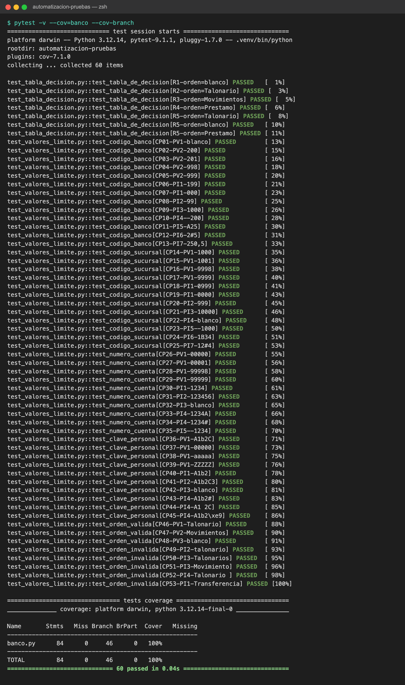
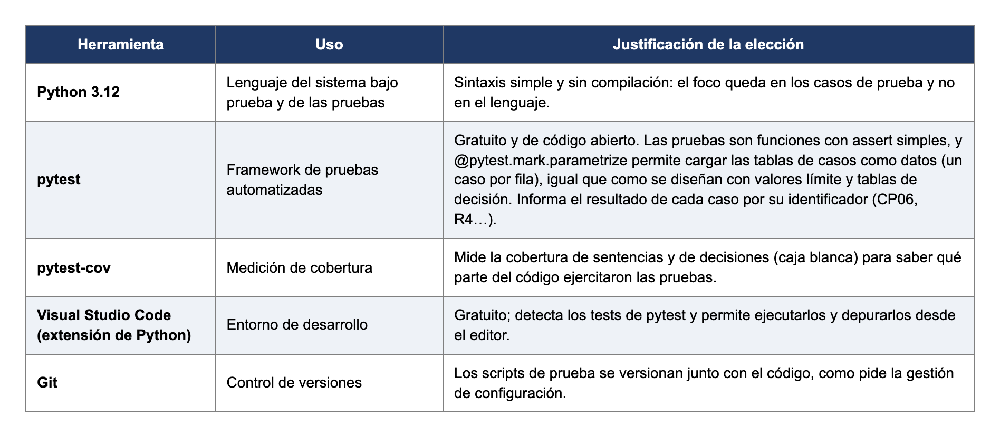

# Automatización de pruebas — aplicación bancaria

Trabajo práctico de **Ingeniería y Calidad de Software** (UTN, 4° año de Ingeniería en Sistemas):
script de pruebas automatizadas con **pytest** que aplica las técnicas de **valores límite** y
**tablas de decisión**.

## Sistema bajo prueba

`banco.py` implementa el procedimiento de operaciones de una aplicación bancaria. Recibe:

| Campo | Regla |
|---|---|
| Código del banco | En blanco o número de 3 dígitos, el primero mayor que 1 |
| Código de sucursal | Número de 4 dígitos, el primero mayor que 0 |
| Número de cuenta | Número de 5 dígitos |
| Clave personal | Valor alfanumérico de 5 posiciones |
| Orden | En blanco, "Talonario" o "Movimientos" |

"Talonario" entrega un talonario de cheques, "Movimientos" entrega los movimientos del mes en
curso y en blanco entrega los dos documentos. Los campos se validan en orden y se informa el
primer error.

## Pruebas

| Archivo | Técnica | Casos |
|---|---|---|
| `test_valores_limite.py` | Valores límite (formato por campo: se varía un atributo y el resto queda válido) | 53 (CP01–CP53) |
| `test_tabla_decision.py` | Tabla de decisión (cada regla es un caso) | 7 (R1–R5) |

Los casos se cargan como datos con `@pytest.mark.parametrize`: agregar un caso es agregar una fila.

**Ejemplo de valores límite**: para el código del banco (rango 200–999) se prueban 200, 201, 998
y 999 (válidos), y 199 y 1000 (inválidos).

**Tabla de decisión**

| | R1 | R2 | R3 | R4 | R5 |
|---|---|---|---|---|---|
| C1 Datos de acceso válidos | S | S | S | S | N |
| C2 Orden | En blanco | Talonario | Movimientos | Otro valor | – |
| A1 Entregar talonario | X | X | | | |
| A2 Entregar movimientos | X | | X | | |
| A3 Informar orden no reconocida | | | | X | |
| A4 Informar error del dato | | | | | X |

En R5 la orden es indiferente (–): se prueba con una orden válida, una en blanco y una inválida
para demostrar que el resultado no cambia.

## Cómo ejecutarlo

```bash
python3 -m venv .venv && source .venv/bin/activate
pip install -r requirements.txt
pytest -v                          # corre las 60 pruebas
pytest --cov=banco --cov-branch    # además mide la cobertura
```

Resultado: **60 pruebas pasadas** y **100 % de cobertura de sentencias y decisiones** sobre
`banco.py`.



Para comprobar que las pruebas detectan errores, se introdujo a propósito un error típico de
frontera (`<= 1` cambiado por `< 1` en la validación del código del banco): falló el caso
**CP06 (entrada 199)** y los otros 59 siguieron pasando.

## Herramientas



Se descartó Selenium porque el sistema no tiene interfaz web (probar la lógica directamente es
más rápido y estable), y JUnit porque requiere Java y más código para la misma prueba
parametrizada.
